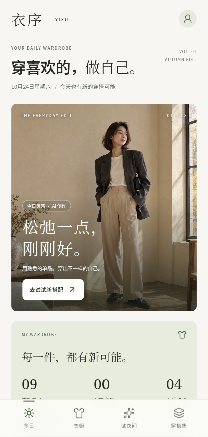
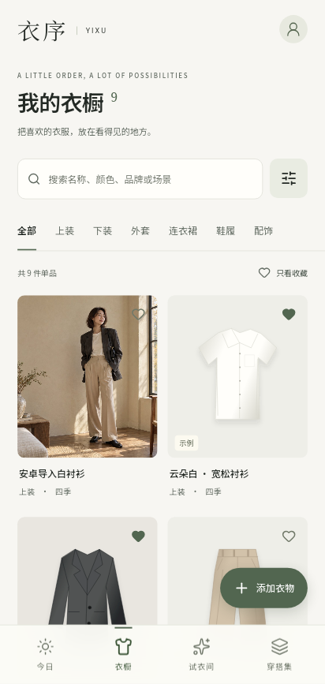
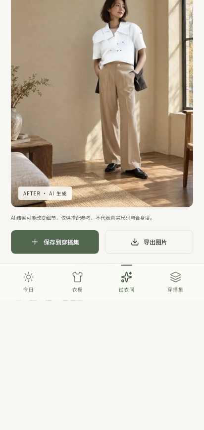

<p align="center"></p>

# YIXU · AI Wardrobe

**Give the clothes you own more possibilities.** A local-first Android wardrobe with outfit planning and online AI virtual try-on.

[简体中文](README.zh-CN.md) · [Android builds](https://github.com/ShenZiLi/ai-outfit/actions/workflows/android.yml) · [Verification](docs/verification.md)

Catalog clothes, build outfits, and preview a garment on a portrait. The app interface is currently in Chinese. This independent project follows the portrait → garment → try-on workflow; it is not affiliated with Taobao.

## App preview

These historical Android emulator screenshots were captured during the October 24, 2026 verification. They show the existing app, including a previously generated try-on result. Fresh real-phone screenshots are pending device unlock; see [the current verification status](docs/verification-2026-10-30.md).

| Today | Wardrobe | Fitting room |
| --- | --- | --- |
|  |  |  |

## Features

- **Wardrobe:** gallery/camera import, categories, colors, seasons, occasions, brand and price; search, filters, sorting, favorites, editing and deletion.
- **Outfits:** combine existing items, save notes, record daily wear, and track wear counts and cost per wear. Local outfit suggestions use rules.
- **Virtual try-on:** select a portrait and top, jacket, bottom or dress; confirm upload, follow the queue, cancel, compare, export, and save the downloaded result.
- **Personal archive:** profile, try-on history, outfit collection, and full JSON backup/restore. Data and photos are stored on the device.
- **Offline use:** organize and browse local content. New AI results require internet access.

First launch includes eight labeled original sample garments and an AI-generated sample portrait. Deleted samples are not reinserted after clearing the wardrobe. Shoes and accessories support cataloging and outfit combinations, but not virtual try-on.

## Install and use

1. Open [Build Android APK](https://github.com/ShenZiLi/ai-outfit/actions/workflows/android.yml), select a successful run, download **yixu-wardrobe-android**, and extract the APK plus SHA256 file. GitHub may require sign-in; artifacts expire after 30 days.
2. Install on Android 8.0+ with Android System WebView / Chrome 111+. Current builds use debug signing.
3. Add clothes in **衣橱** (Wardrobe); choose a portrait and garment in **试衣间** (Fitting room), then confirm upload.
4. Save combinations/results in **穿搭集** (Outfits). Open the top-right avatar to manage your profile and export backups.

Local packaging writes `artifacts/yixu-wardrobe-1.0.0.apk`, an ignored build output, not a file distributed in Git. Cloud/local debug keys can differ: export your wardrobe before uninstalling if an update reports a signature mismatch, then reinstall and restore.

## AI services and privacy

| Provider | Limits |
| --- | --- |
| FASHN · default | Public FASHN VTON 1.5 demo on Hugging Face, no API key. Requires connectivity to the service; availability, queue time and GPU quota vary. |
| IDM-VTON · research fallback | Tops only, noncommercial research restrictions. Earlier checks encountered public server errors. |
| Alibaba Cloud · optional | Your own Beijing-region Try-On Plus access and key; charges may apply. Protocol tests exist; no real-account validation is claimed. |

Photos are uploaded only after confirmation. Remote processing/retention follows the provider's policies. Keys remain in the current session and are excluded from backups. The app has no accounts, ads or behavioral analytics.

AI can change clothing details and cannot establish size or fit. Height/weight are profile records only. Uninstalling removes local data; backups contain photos. Production use needs a stable service and review of applicable terms.

## Development

Requires Node.js 22.12+ (CI uses 24), npm, JDK 17, Android SDK Platform 36 and Build Tools 36.1.0. Dependencies are locked in `package-lock.json`.

```sh
git clone https://github.com/ShenZiLi/ai-outfit.git
cd ai-outfit
npm ci
npm run dev
```

Open Vite's printed address, normally `http://localhost:5173`. Browser and Android app storage are separate.

```sh
npm run build
npm run preview
npm test
npm run format:check
npx playwright install chromium
npm run test:e2e
```

### Android build

**Windows:** set `ANDROID_HOME` or `ANDROID_SDK_ROOT`, then run `npm run android:build`. The PowerShell script bundles web assets, builds/lints Android, and writes the APK and checksum.

**macOS/Linux:** configure `android/local.properties` with `sdk.dir=/absolute/path/to/sdk`, then:

```sh
npm run build
mkdir -p android/app/src/main/assets/www
cp -R dist/. android/app/src/main/assets/www/
cd android
bash ./gradlew --console=plain assembleDebug lintDebug
```

The APK is `android/app/build/outputs/apk/debug/app-debug.apk`. Android Studio can open `android/`. Rebundle web assets after frontend changes. Keep SDK paths, secrets, caches and signing keys out of Git; public distribution needs release signing.

CI installs dependencies, checks formatting, runs unit tests, builds the frontend, and builds/lints Android on pushes to `main` / `codex/**`, pull requests and manual dispatch.

### Integration checks

`YIXU_LIVE_AI=1 npx playwright test tests/live-tryon.spec.ts --workers=1` uploads only project samples to the public GPU service; network/quota limits can prevent completion. Normal tests do not need it.

`npm run test:android` targets only the dedicated `emulator-5582`, not an arbitrary connected phone. See [fixture preparation and historical checks](docs/verification.md). [Current verification status](docs/verification-2026-10-30.md) records the completed build checks and the pending real-phone installation and screenshots.

## Structure

| Path | Purpose |
| --- | --- |
| `src/domain.ts`, `src/storage.ts` | Wardrobe rules, validation, backups and IndexedDB |
| `src/screens/`, `src/components/` | React screens, forms and dialogs |
| `src/tryon.ts` | Provider adapters, cancellation and result download |
| `android/app/src/main/java/` | Android host, system photos/files and restricted network bridge |
| `public/icons/` | Selected imagegen glacier-blue origami icon |
| `docs/icon-concepts/` | Design candidates and generation prompts |

## Contribute and credits

[Open an issue](https://github.com/ShenZiLi/ai-outfit/issues) with reproduction steps, device/WebView version and sanitized logs, or send a focused PR. Run relevant checks; do not commit personal photos, credentials, local configuration or build outputs.

Read [project rules](AGENTS.md), [research decisions](docs/research.md) and [third-party notices](THIRD_PARTY_NOTICES.md). Editorial/sample portrait images and the selected icon were generated with imagegen; sample garment SVGs are original assets. No project-level code license has been declared; dependency and model licenses apply separately.
